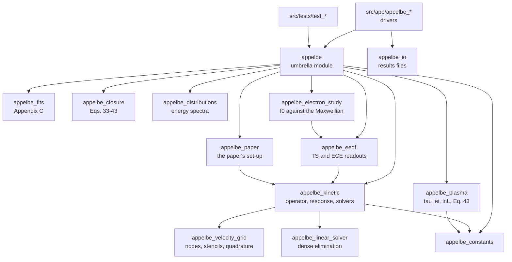

# Architecture



## Two routes to one closure

The closure $(j^\nu, \zeta^\nu)$ is available two ways, and they deliberately coexist:

1. **Algebraic** (`appelbe_fits`): the Appendix C tables, valid only for α particles in DT; cheap enough for every cell
   of a fluid code.
2. **Kinetic** (`appelbe_kinetic`): Eq. 13 discretised as in Appendix B. It is required for anything the fits do not
   cover: the isotropic-population effect (Sec. VI), $\beta_\perp$ and $\beta_\wedge$, other species, energy spectra — and to
   validate route 1.

## Design decisions

- **Simplicity over performance.** Dense matrices and Gaussian elimination, no LAPACK, no parallelism: a response costs
  milliseconds, the full reproduction four minutes.
- **One solve, three right-hand sides.** `response` solves the electric, thermal and unit-flux drives together; the
  fast-ion problem is linear in the flux and in $\gamma_\alpha$, so a unit flux suffices.
- **Complex arithmetic for the tensors.** $(\perp, \wedge) = (\text{real}, \text{imaginary})$ makes the magnetised problem one
  complex system and the tensor algebra of Eqs. 25–35 complex products. The paper's real procedure is kept as an
  alternative method.
- **Assemble on the full grid, then reduce.** Every row of $G$ is built on all $N$ nodes and the boundary conditions fold
  or drop columns, so the stencils never special-case the boundaries.
- **Align a node with $u_\alpha$.** Essential for convergence of the fast-ion moments ([Kinetic solver](kinetic-solver#node-alignment)).
- **The paper's choices in one module.** `appelbe_paper` isolates what was inferred about the paper, so physics code never
  depends on it.
- **No global state.** Every object is passed explicitly; the library has no mutable module-level state (as required for
  the coupling with [adam](https://github.com/szaghi/adam)).

## Sources

```
src/lib/      library, one module per file (appelbe.F90 re-exports the public API)
src/app/      drivers appelbe_*: one per figure or section, write results/
src/tests/    test programs test_* and the assertion helper
scripts/      run_tests.sh, make_figures.sh, make_report.sh, docs_examples.py,
              digitize_paper.py, report_numbers.py, *.gp previews
report/       appelbe_report.tex, data/ (curves extracted from the paper)
docs/         this site; examples/src/ holds the programs of the tutorial and cookbook
```
