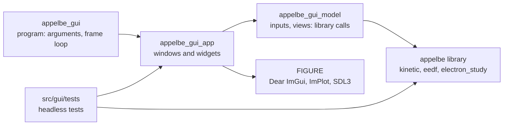

# Desktop GUI

`appelbe-gui` is a desktop program over the library for the [non-Maxwellian electron](electrons) work: choose an
electron $f_0$ (a Maxwellian, the bipolar distortion, or a table read from a file), see what Thomson scattering and ECE
read from it, and how it changes transport and the α closure. It is built with
[FIGURE](https://github.com/szaghi/figure) (Dear ImGui and ImPlot for Fortran) and is meant for a physicist who does not
build Fortran: it ships as a prebuilt program for macOS, Windows and Linux (issue #2).

The GUI adds **no physics**. Every number it shows is computed by the library, by the same procedures the driver
`appelbe_electrons` calls ([the study of a distorted f₀](electrons#the-study-of-a-distorted-f0)); every number is
checked by a headless test against a direct library call.

## Build

The GUI has its own fobos, `fobos-gui`. The library's fobos, its tests and its CI never read it, so they never pull
FIGURE, SDL3 or CMake.

```bash
fobis fetch -f fobos-gui                          # PENF and FIGURE (tag v0.8.0) into src/gui/third_party/
fobis build -f fobos-gui --mode gui-gnu           # bin/gui/appelbe-gui
fobis build -f fobos-gui --mode gui-tests-gnu     # the headless tests into exe/gui/
fobis rule -f fobos-gui --ex gui-tests            # run them (scripts/run_gui_tests.sh)
```

`fobis fetch -f fobos-gui` clones FIGURE at the tag `v0.8.0` and builds it with FIGURE's own fobos (`use=fobos`,
mode `figure-static-gnu`), whose pre-build step builds FIGURE's native layer (Dear ImGui, ImPlot, SDL3) with CMake: the
first fetch needs CMake 3.24+, a C++17 compiler, and network access; on Linux, SDL3's X11/Wayland development packages
([FIGURE's requirements](https://szaghi.github.io/figure/guide/install#requirements)). FIGURE is pinned to a tag
because its API may change before its v1.0.

| Mode | Output | Flags |
|---|---|---|
| `gui-gnu` | `bin/gui/appelbe-gui` | `-O2 -frecursive` |
| `gui-gnu-debug` | `bin/gui-debug/appelbe-gui` | the library's debug flags (`-fcheck=all`, FP traps) and `-frecursive` |
| `gui-tests-gnu` | `exe/gui/test_gui_*` | as `gui-gnu` |
| `gui-tests-gnu-debug` | `exe/gui-debug/test_gui_*` | as `gui-gnu-debug` |

macOS and Windows link other system libraries: `--varset macos` or `--varset windows` (the same varsets as FIGURE's
fobos).

```bash
bin/gui/appelbe-gui                  # a window
bin/gui/appelbe-gui --remote 8080    # no window: served to a web browser (FIGURE's remote mode)
bin/gui/appelbe-gui --version
```

`--remote PORT` is a fallback for a machine without a usable OpenGL 3: the program prints an address with an access
token, and the interface runs in a web browser.

## Architecture



```
src/gui/appelbe_gui.F90        the program: --remote, --version; the frame loop
src/gui/appelbe_gui_app.F90    gui_object: the windows, declared every frame from the state (gui%frame)
src/gui/appelbe_gui_model.F90  gui_inputs, the views, solve_job, and the library calls that compute them (no FIGURE)
src/gui/appelbe_gui_tasks.F90  solve_work: a solve_job's steps on a FIGURE worker thread
src/gui/tests/                 headless tests (test_gui_*) and their checks (gui_assert)
src/gui/share/                 the example f0 table shipped with the program
fobos-gui                      the GUI's build; FIGURE and PENF fetched into src/gui/third_party/
```

- **State and frame.** `gui_object` holds the inputs (`gui_inputs`, defaults = the driver's reference case: 3.45 MeV α
  at $T_e$ = 10 keV, $n_\alpha/n_e = 10^{-3}$, $Z_i = 1$, 801 nodes, $u_{\max} = 7$, bipolar $A = 0.1$, $u_0 = 2$,
  $w = 0.25$) and the views computed from them. `gui%frame(app)` declares one frame. The program and the tests call
  the same procedure, so the tests drive the interface that ships (FIGURE's
  [advice](https://szaghi.github.io/figure/guide/testing#test-the-interface-you-ship)).
- **The model** (`appelbe_gui_model`) turns the inputs into library calls: `physical_params` (the masses are the
  library's constants for the named species, so the default inputs give the driver's parameters exactly),
  `init_electrons` (the chosen $f_0$), `load_table` (`read_table`, `electron_table_check`), `compute_f0_view`
  (`electron_profile` against the Maxwellian at $T_e$ and the one at $T_{\text{kin}}$, the TS and ECE temperatures). It
  uses no FIGURE, so it can run on a worker thread.
- **Errors are messages.** An input the library rejects (a negative $f_0$, an even number of nodes, $u_\alpha$ not
  resolved, a table that does not decay before $u_{\max}$) comes back through `stat` and `errmsg`
  ([kinetic solver](kinetic-solver#the-operator)) and is shown in red; the program keeps running. `input_error` rejects
  values out of their domain (a temperature, an energy, a mass not positive) before any library call.
- **Recomputation.** The $f_0$ panel costs milliseconds (operator assembly, no solve): it is recomputed on every input
  change, on the frame loop's thread. The solves (readouts, $f_1$, the sweep in $\omega\tau$: about 60 responses, seconds
  at 801 nodes) run as a FIGURE task on a worker thread ([Threads](#threads)), so the window never freezes.

## Threads

A FIGURE [task](https://szaghi.github.io/figure/guide/processes#tasks) runs `work(h, data)` on a worker thread, on its
own copy of `data`. The GUI's work is `solve_work` (`appelbe_gui_tasks`): it runs the steps of a `solve_job`
(`appelbe_gui_model`), reports the progress after each, and returns at the first step after a cancel. Step 1 builds the
operators, the readouts (`electron_readouts`) and the $f_1$ profiles (`electron_f1`); each further step the responses at
one $\omega\tau$ of the $f_0$, of the Maxwellian at $T_e$ and of the one at $T_{\text{kin}}$. It never draws.

This is safe because the code a task runs shares nothing with the main thread. The audit of `src/lib`, every module
read (2026-11-20, against the tree of this commit):

| Hazard | Finding |
|---|---|
| Module variables | none: every module-level entity is a `parameter` (constants, the `F0_*`, `CURVE_*` codes, headers) |
| `save`, `data`, `common`, initialised local variables (implicitly `save`) | none; the `= value` in `kinetic_params`, `kinetic_response`, `kinetic_operator`, `velocity_grid` are default initialisations of type components, not saved variables |
| Large local arrays made static by gfortran | none can be: every procedure is compiled with `-frecursive` (`fobos-gui`), which keeps all locals on the stack (without it gfortran puts fixed-size locals above `-fmax-stack-var-size` in static memory); FIGURE gives each worker 64 MiB of stack, the largest automatic arrays here are a few vectors of `n` reals |
| gfortran's `-fcheck=recursion` (in `-fcheck=all`), which stops two threads entering one non-`recursive` procedure | not generated with `-frecursive` (checked: a procedure that calls itself compiles and runs under `-frecursive -fcheck=recursion`), so the debug build runs tasks too |
| Procedure arguments (`electrons`, `distribution`) | module functions (`pure`), no host association, no trampoline |
| I/O | `read_table` opens its own unit (`newunit`), only on the main thread (a table is loaded from the dialog); a task does no I/O. `open_results` (the drivers' `mkdir -p`) is never called by the GUI |
| `error stop` reachable from a task | none for a valid build: `init`'s rejections go through `stat` (step 1 fails with the message instead); `solve_dense`'s "singular matrix" needs a singular $G + i\omega\tau$, which the physical operator is not; the remaining ones are programming errors (a distribution without its parameters) |
| PENF | only its kind parameters are used |

The model (`appelbe_gui_model`) has no module variable either. A future change to `src/lib` must keep these properties:
a module variable, a `save`, or an initialised local variable would make the GUI's results depend on what another
thread is doing. `test_gui_task` would catch most such regressions (two tasks and the main thread compute at once and
must agree bit for bit), but not all: keep the audit above current.

## Tests

The tests are headless (`app%init_headless`: no window, no display, no GPU) and drive the interface through
`figure_testing`: they type values into the fields by path (`'Inputs/A'`), draw frames until the interface is idle,
and compare what the panels draw with a **direct library call** on the same inputs, bit for bit. The oracle is never
a snapshot of the GUI's own output.

| Test | Checks |
|---|---|
| `test_gui_task` | a `solve_job` run as a task equals the same job on the main thread bit for bit (readouts, $f_1$, every response), with two tasks and the main thread computing at once; the readouts and a response equal `electron_readouts` and `kinetic_operator%response` called directly; a cancel stops the task early with consistent data; a rejected input fails the job with the library's message, no stop |
| `test_gui_f0` | the windows are drawn, no id conflict, every interactive item named; the default $f_0$ is the driver's; $A$, $w$, $T_e$ typed into the fields give the library's $f_0$, grid and $u_\alpha$; the equal-energy Maxwellian; a rejected input is a message and the view comes back; a table is read, a missing one reported |

```bash
fobis build -f fobos-gui --mode gui-tests-gnu && scripts/run_gui_tests.sh exe/gui
fobis build -f fobos-gui --mode gui-tests-gnu-debug && scripts/run_gui_tests.sh exe/gui-debug
```
