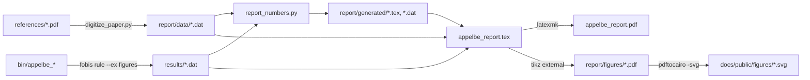

# Report pipeline

`report/appelbe_report.pdf` compares every curve and number of the paper with the last run. Nothing in it is typed by
hand.



Every figure of the report is also the figure of this site. The report externalises each `tikzpicture` (TikZ
`external` library, hence `-shell-escape`) to `report/figures/<name>.pdf`, and `make_report.sh` converts each one to
`docs/public/figures/<name>.svg`. The two can never disagree, and a figure added to the report needs only a
`\tikzsetnextfilename{<name>}` before its `tikzpicture` and an `.svg">` on a page.
`report/figures/` is emptied before each build, because TikZ `external` checks the plot code, not the data files.

```bash
fobis rule --ex figures      # results/
fobis rule --ex report       # scripts/make_report.sh: report_numbers.py, latexmk -pdf, then the SVGs of the site
```

## Curves from the paper

`scripts/digitize_paper.py` reads the paper's figures as **vector graphics**: every curve is a filled outline of the
stroked line, every tick a thin rectangle. With `mutool trace`:

1. each axis is calibrated by a least-squares fit of the tick positions to the tick values read from the figure
   (residual ≤ 1.1×10⁻⁴ of the span for every panel);
2. each outline is reduced to its centre line: the midpoint of every outline vertex and its projection on the opposite
   side of the stroke, exact on straight segments; for dashes, points closer than 0.4 stroke widths to the outline
   (wrong pairings at dash ends) are dropped; dotted lines give their dot centroids.

The accuracy is checked on the dotted Maxwellian of Fig. 1, which must be $e^{-u^2}$: the systematic error (offset,
shift, scale) is $10^{-5}$ of the axis span, the scatter $2\times10^{-4}$. The same tool reads the Epperlein–Haines curve of
Davies et al. (2021), Fig. 4(a), drawn as stroked polylines. The PDFs are git-ignored (`references/`); the extracted
curves (`report/data/*.dat`) are committed.

## Numbers and tables

`scripts/report_numbers.py` reads `results/` and `report/data/` and writes `report/generated/`: a macro file with every
number quoted in the text, one file per table body, and the Fig. 5 heat flows re-formed with the Epperlein–Haines
$\beta$. Our curves are interpolated at the paper's abscissae with a cubic spline (the agreement is at the $10^{-3}$
level, where linear interpolation would add error). It also infers the paper's $\beta$ from its Fig. 5, separates
interpolation and fit errors of the algebraic closure, and summarises footnote 30.

## The LaTeX source

`report/appelbe_report.tex` draws its figures with pgfplots from `../results/`, `data/` and `generated/`. Table bodies
are pulled in with `\inputtable` (the `\@@input` primitive), because LaTeX's robust `\input` breaks a following
`\bottomrule`; number macros use `\ensuremath`. `make_report.sh` forces pdflatex (`-e '$pdflatex=...'`), whatever a
user's `~/.latexmkrc` maps it to.
